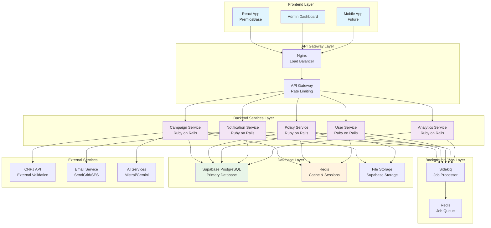
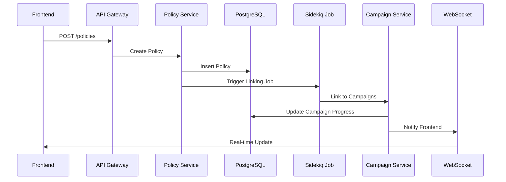
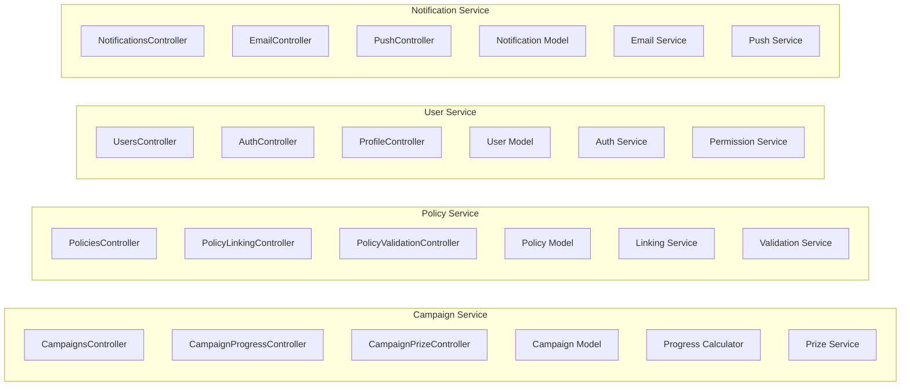
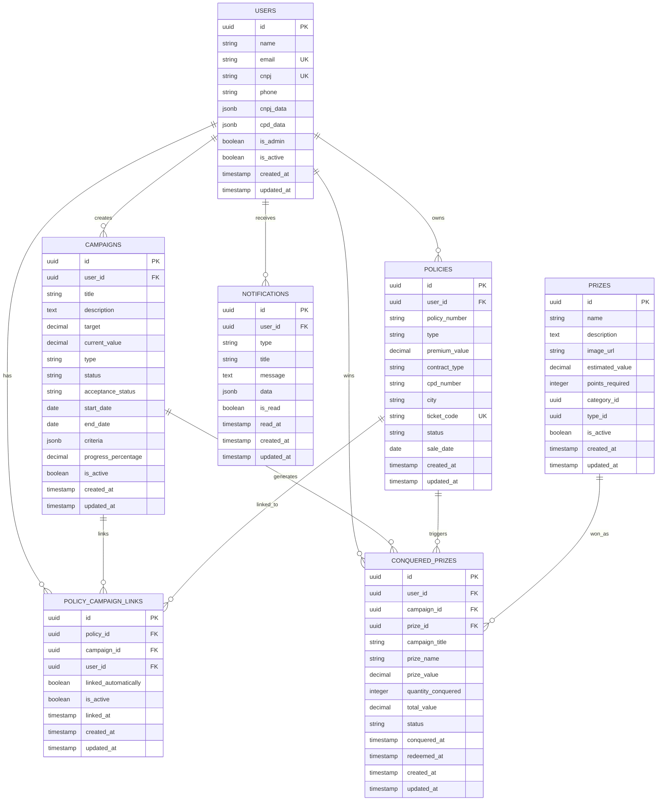
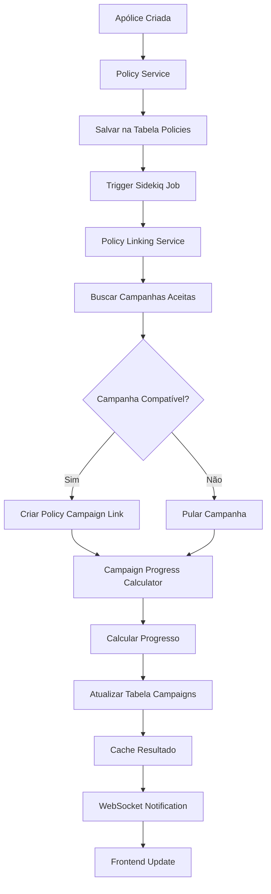
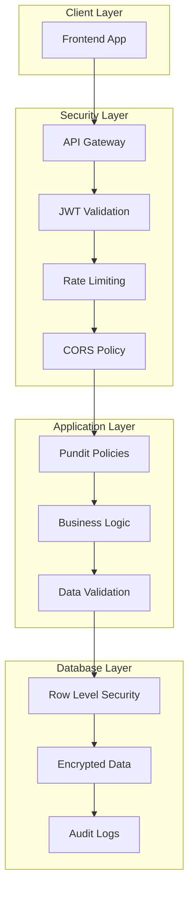
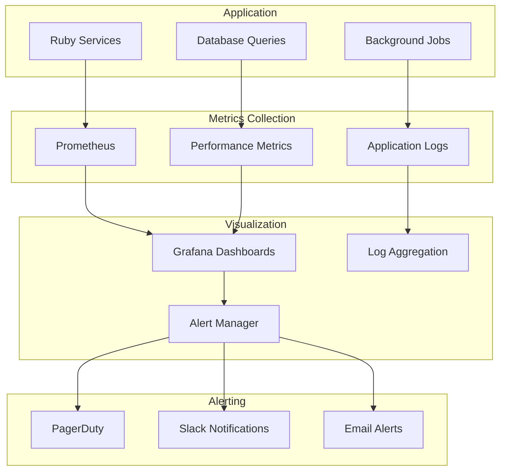
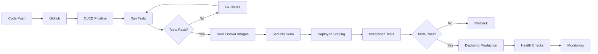
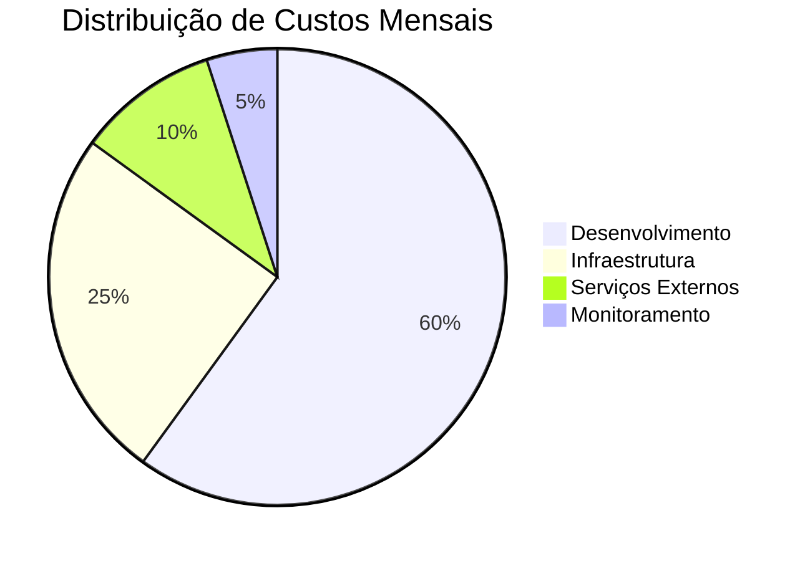
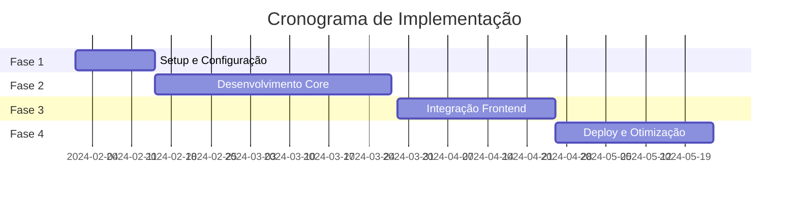

# 🏗️ ARQUITETURA PREMIOSBASE - DIAGRAMA PARA LINEAR

## 📊 DIAGRAMA DE ARQUITETURA PRINCIPAL

## 🔄 FLUXO DE DADOS PRINCIPAL

## 🏗️ ESTRUTURA DE MICROSERVIÇOS

## 🗄️ SCHEMA DO BANCO DE DADOS

## 📊 FLUXO DE PROGRESSO DE CAMPANHA

## 🔐 SEGURANÇA E AUTENTICAÇÃO

## 📈 MONITORAMENTO E OBSERVABILIDADE

## 🚀 DEPLOYMENT PIPELINE

## 💰 CUSTOS E RECURSOS

## 🎯 ROADMAP DE IMPLEMENTAÇÃO

---

## 📋 INSTRUÇÕES PARA O LINEAR

### **Como usar estes diagramas no Linear:**

1. **Copie o código Mermaid** de qualquer seção acima
2. **Cole no Linear** usando a funcionalidade de diagramas
3. **Personalize** conforme necessário para sua equipe
4. **Use como referência** durante o desenvolvimento

### **Diagramas recomendados para diferentes contextos:**

- **Arquitetura Geral**: Para apresentações e documentação
- **Fluxo de Dados**: Para entender processos
- **Schema do Banco**: Para desenvolvimento e migração
- **Pipeline de Deploy**: Para DevOps e CI/CD
- **Roadmap**: Para planejamento de sprints

### **Benefícios no Linear:**
- ✅ Visualização clara da arquitetura
- ✅ Colaboração em tempo real
- ✅ Integração com issues e tasks
- ✅ Versionamento de diagramas
- ✅ Acesso fácil para toda a equipe

---

**Estes diagramas estão prontos para serem usados no Linear e ajudarão muito no planejamento e execução do projeto!**